# Wildfire AI: can AI see from the air which homes a wildfire will destroy?

This project tests whether today's AI image models can judge wildfire damage and wildfire risk for individual homes
from aerial photos, and measures the answer against what really happened in California fires. It also includes a
web demo with two parts: a map of live public wildfire data, and a browser for every AI answer in the evaluation.

[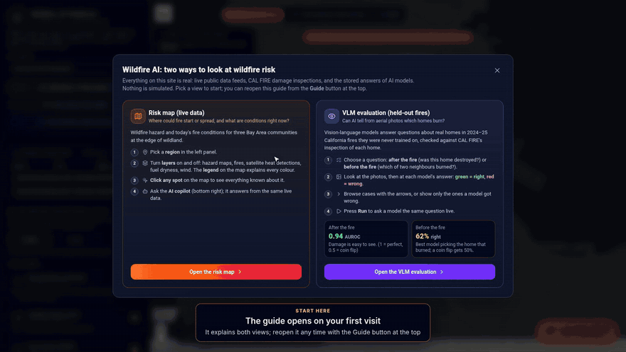](docs/assets/tutorial.mp4)

*The web demo, recorded from the running app. **[Full 4-minute tutorial](docs/assets/tutorial.mp4)** (captions, no
audio).*

**Contents**

1. [The question](#1-the-question)
2. [How we test it](#2-how-we-test-it)
3. [What we found](#3-what-we-found)
4. [The web demo](#4-the-web-demo): [risk map](#41-risk-map-live-public-data) ·
   [map data sources](#42-map-data-sources) · [AI evaluation browser](#43-ai-evaluation-browser) ·
   [street-level view](#44-street-level-view)
5. [What comes next](#5-what-comes-next)
6. [Run it yourself](#6-run-it-yourself)
7. [Repository, documents and licences](#7-repository-documents-and-licences)

---

## 1. The question

After a wildfire, inspectors walk every street and record which homes were destroyed. Before a fire, home owners,
fire agencies and insurers would like to know which homes are most at risk. Aerial photos cover every home, and
*vision-language models* (VLMs: AI models such as Claude or Qwen that read an image and answer questions about it in
words) are increasingly used to "read" risk from such photos.

That leads to two questions this project answers with real outcomes:

1. **After a fire:** can an AI model tell from an aerial photo whether a home was destroyed? If yes, damage
   surveys could be faster.
2. **Before a fire:** can it tell which homes *will* be destroyed? If yes, photos could guide where to clear
   vegetation or harden homes.

## 2. How we test it

A fair test needs three things: true outcomes, photos taken at the right time, and fires the models have never
seen. This is how each is ensured.

**True outcomes.** CAL FIRE's Damage Inspection records (DINS) list 132,522 inspected structures. A home counts as
*destroyed* when inspectors recorded Destroyed or Major damage (more than 25%), and as *survived* otherwise.

**Photos from the right time.** Photos come from Esri World Imagery Wayback, an archive of past satellite and aerial
mosaics. The date a mosaic was *published* can be years after the photo was *taken* (a median of 585 days here), so
the capture date is read for each home separately. A pre-fire photo must be taken before the fire started; a
post-fire photo is the first one taken within a year after. Homes whose photo date cannot be verified are dropped,
never replaced by a newer photo.

**Fires the models have never seen.** Models are trained or tuned only on 2019–23 fires and tested on 2024–25 fires
(83 fires in the test set), and no test home lies within 100 m of a training home. A separate set of 2019–23
fires, kept out of the first round of tests, serves to repeat the key before-the-fire tests.

**Three tasks.**

| Task | Question | Test set |
|---|---|---|
| **T3, after the fire** | Was this home destroyed? The model sees the post-fire photo, or the photos before and after. | 1,246 homes from 83 fires |
| **T2, before the fire** | Two neighbouring homes 15–100 m apart burned in the same fire, and exactly one was destroyed. Which one? | 403 pairs from 13 fires |
| **T1, before the fire** | Will this single home be destroyed? | 238 homes from 8 fires |

T2 is the strictest test of risk. Both homes faced the same fire, weather and firefighting, so only what differs
between the two homes themselves (roof, yard, vegetation, spacing) can explain which one burned.

**Models compared.**
- *Zero-shot VLMs* (used as they are, without training on this data): Claude Sonnet 5.5, Claude Haiku 5.5,
  Qwen3.8-27B, MiniMax-M3 and Qwen3.5-4B.
- *Fine-tuned VLMs:* Qwen3.5-4B and Qwen3.5-9B, adapted with LoRA (a light form of fine-tuning) on 1,646 homes from
  the 2019–23 fires.
- *Simple baselines:* a *linear probe* (a frozen image encoder, DINOv2, followed by logistic regression) and a model
  that uses only building records (structure type, year built).

**Scores.**
- *AUROC* for single homes: the chance that the model rates a randomly picked destroyed home as more likely
  destroyed than a randomly picked survivor. 1 is perfect; 0.5 is a coin flip.
- *Pair accuracy* for T2: how often the model picks the destroyed neighbour. 0.5 is a coin flip.
- Every model request and answer is logged. Answers that cannot be read count as a coin flip (0.5).

## 3. What we found

| T3, after the fire (AUROC) | | T2, before the fire (pair accuracy) | |
|---|---|---|---|
| Claude Sonnet 5.5, photos before + after | **.936** | Claude Sonnet 5.5, photos | **.620** |
| Claude Haiku 5.5, photos before + after | .918 | Building-records model (type, year built) | .604 |
| Qwen3.5-9B fine-tuned, post-fire photo | .903 | MiniMax-M3, photos | .603 |
| Qwen3.5-4B fine-tuned, post-fire photo | .892 | Qwen3.8-27B, photos | .588 |
| Claude Sonnet 5.5, post-fire photo | .892 | Claude Sonnet 5.5, building records only | .578 |
| Linear probe (DINOv2), post-fire photo | .881 | Claude Haiku 5.5, photos | .571 |
| Qwen3.8-27B, photos before + after | .742 | | |
| Qwen3.5-4B zero-shot, post-fire photo | .644 | | |

*Claude models were run on a fixed subset of 400 of the 1,246 test homes.*

**1. After a fire, damage is easy to see.** The best zero-shot model reaches .936. A small open model that scores
.644 out of the box reaches .892 after fine-tuning. However, the simple linear probe does about as well (.881), so
for this task fine-tuning a VLM is not better than a much cheaper image model.

**2. Before a fire, aerial photos say little about which home will burn.** The best model picks the destroyed
neighbour 62% of the time. On the separate set of fires used to repeat the test, the same model scores 55.5%, and
the test that it beats a coin flip does not pass once corrected for multiple tests. Over both sets, the VLMs do
about as well as knowing each home's structure type and year built (59–60%). Judging single homes (T1) gives the
same picture: zero-shot models reach only .52–.61 AUROC.

**3. The way a test is split changes the answer.** If homes are split at random, so that a model trains on some
homes of a fire and is tested on others from the same fire, pre-fire scores rise by .16 AUROC. Testing on whole,
later fires removes this inflation.

The tests behind findings 1 and 2 were registered before they were run (see [section 7](#7-repository-documents-and-licences)).
How the ground truth, test sets, prompts and scoring work in detail, and all 13 experiments: [section 4.3](#43-ai-evaluation-browser).
All numbers with confidence intervals: **[docs/RESULTS.md](docs/RESULTS.md)**.

## 4. The web demo

The demo has two views, switched by the **Risk Map** and **VLM Evaluation** tabs at the top of the page. A short guide opens on the first visit and can be reopened
with **Guide**. **Nothing is mocked:** every value is fetched from a public source or read from a stored result of
the evaluation, and if a source is down the page says so instead of showing a placeholder.

| | Risk map | AI evaluation browser |
|---|---|---|
| **Answers** | Where could fire start or spread, and what are conditions right now? | Can AI tell from aerial photos which homes burn? |
| **Step 1** | Pick a region: San Bruno, the San Jose foothills or the Santa Cruz Mountains. | Choose a question: *after the fire* (T3) or *before the fire* (T2). |
| **Step 2** | Switch layers on and off; the legend explains every colour. | Read the scoreboard: one bar per model. |
| **Step 3** | Click any spot for a summary from all sources. | Open one home: its photos, the inspection result and every model's answer. |
| **Step 4** | Drag the weather time slider from the past day to about 10 days ahead. | Press **Run** to ask a model the same question again, live. |

### 4.1 Risk map (live public data)

The map shows wildfire hazard, current fires and fire weather for the selected region. The left panel holds the
region picker, the current conditions at the region centre, the weather controls and the layer switches. Under each
switch a status line says what was loaded and from when, or why a source failed.

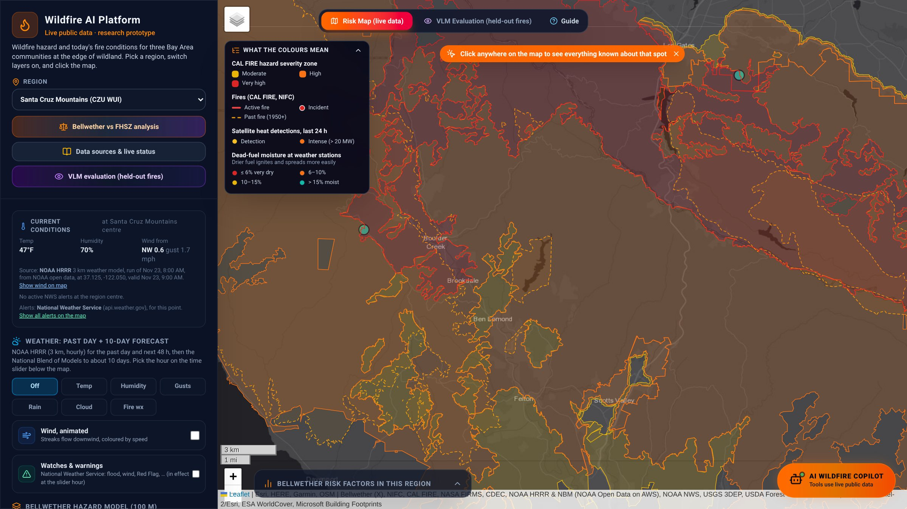

*Santa Cruz Mountains with CAL FIRE hazard severity zones, past fire perimeters (dashed) and a fuel-moisture station.
The legend at the top left lists only the layers that are switched on.*

**Location summary.** Clicking any spot asks every source about that point: weather now, hazard zone, burn
probability, land cover, buildings, slope, the nearest fuel-moisture station and past fires. The **Street View**
link next to the coordinates opens Google Street View there.

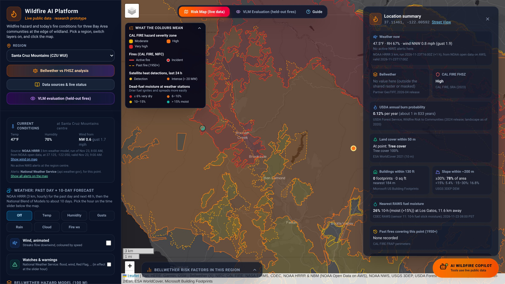

**Weather and time slider.** Pick a weather field (temperature, humidity, gusts, rain, cloud cover or a fire-weather
index), switch on the animated wind and the National Weather Service alerts, and drag the time slider. Grey marks the
past day, blue the hourly forecast for the next 48 hours, violet the longer forecast to about 10 days. Hovering the
map shows the values under the pointer; **Play** steps through the hours.

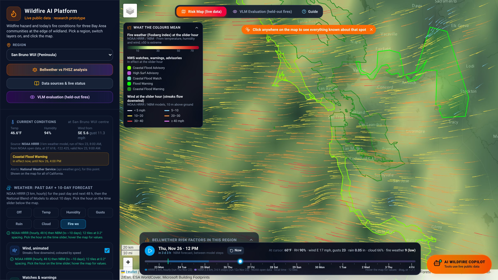

**Data sources & live status** lists every source with its provider, resolution and update frequency, and checks
each one when it opens. Two further tools: **Bellwether vs FHSZ analysis** compares a partner hazard model with the
state hazard zones cell by cell, and the **AI copilot** answers questions using the same live sources (it needs an
LLM key on the server).

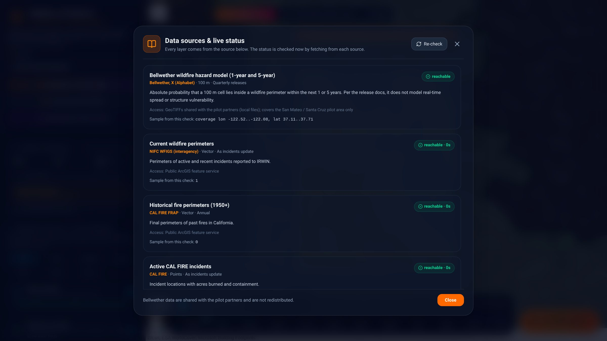

### 4.2 Map data sources

Every layer comes from a public service queried live, except where noted. The server keeps the last good answer of
each source and shows it, marked with its time, if the source stops answering. The browser keeps every layer it has
loaded, so returning to a region is instant.

**Fire hazard: how likely is fire here in a typical year?**

| Layer | What it shows | Source | Resolution · update |
|---|---|---|---|
| Annual burn probability | Simulated yearly chance that fire reaches each spot. Covers the whole country. | USDA Forest Service, Wildfire Risk to Communities ([doi:10.2737/RDS-2020-0016-2](https://doi.org/10.2737/RDS-2020-0016-2)), public image service | 30 m · landscape as of 2020 |
| Fire Hazard Severity Zones | California's official Moderate / High / Very High hazard zones. | CAL FIRE, public map service (state areas 2023, local areas 2025) | Polygons · map revisions |
| Bellwether 1-year / 5-year hazard | Chance that a 100 m cell burns within 1 or 5 years, from a machine-learning model. | Bellwether (X, Alphabet); files shared with the pilot partners, **not redistributed**; pilot area only (not San Jose) | 100 m · quarterly |

**Fire activity: what is burning now, and what burned before?**

| Layer | What it shows | Source | Resolution · update |
|---|---|---|---|
| Current fire perimeters | Outlines of active and recent fires. | NIFC WFIGS (national interagency), public map service | Polygons · as fires are mapped |
| CAL FIRE incidents | Incident locations with acres burned and containment. | CAL FIRE incident feed | Points · as incidents update |
| Past fires (1950 on) | Final outlines of past fires. | CAL FIRE FRAP, public map service | Polygons · yearly |
| Satellite heat detections | Hot spots seen by satellites in the last 24 hours. | NASA FIRMS, VIIRS instruments on three satellites | 375 m · several passes a day |

**Fuel, terrain and land: how readily would fire spread here?**

| Layer | What it shows | Source | Resolution · update |
|---|---|---|---|
| Fuel moisture | Moisture of small dead fuels at weather stations; 6% or less is very dry. | California Data Exchange Center (CDEC), RAWS stations | Stations · hourly |
| Vegetation greenness (NDVI) | How green the vegetation is, from one recent cloud-free scene (date shown). | Copernicus Sentinel-2, via Esri | 10 m · about every 5 days |
| Terrain slope | Steepness, classed at 15 / 30 / 50%; fire runs faster uphill. | USGS 3D Elevation Program; slope computed by the app | 10–30 m · static |
| Land cover (location summary) | Trees, shrubs, grass, buildings and so on around a point. | ESA WorldCover 2021 | 10 m · 2021 |
| Building footprints | Outline and area of each building (zoom in to see them). | Microsoft US Building Footprints (local copy for the Bay Area) | Polygons · mostly 2018–20 |

**Weather: what are conditions now and in the coming days?**

| Layer | What it shows | Source | Resolution · update |
|---|---|---|---|
| Weather fields and wind, past 24 h to 48 h ahead | Temperature, humidity, wind and gusts at 10 m, hourly rain, cloud cover. | NOAA HRRR weather model, read from NOAA's open data on AWS | 3 km · new run every hour |
| Same fields, 2 to about 10 days ahead | As above; between the model's time steps the values are interpolated, and the readout says so. | NOAA National Blend of Models (NBM), NOAA's open data on AWS | 2.5 km · steps of 3, later 6 hours |
| Fire-weather index | Fosberg index, combining temperature, humidity and wind; 50 or more is extreme. | Computed in the browser from the fields above | As above |
| Watches, warnings and advisories | Red Flag, wind, flood and other alerts in effect at the slider hour, in the National Weather Service colours. | National Weather Service (api.weather.gov), all of California | Forecast zones · every 5 minutes |
| Current conditions | Weather now at the region centre or a clicked point, with the alerts there. | The HRRR data above (outside California: HRRR via Open-Meteo) | 3 km · hourly |

The server downloads only the weather fields it needs from each NOAA model file (about 10 MB per forecast hour
instead of 100–170 MB) and stores them on a 3 km grid over California
([`backend/noaa_grid.py`](backend/noaa_grid.py)). It checks for new model runs every 10 minutes.

**California data cache: what shapes fire behaviour everywhere in the state?** A second set of layers is kept on our
own server for all of California, so the map and the AI copilot can read it in milliseconds. They are listed in the
*California data (local cache)* panel; clicking the map adds their values at that point to the location summary.

| Group | Layers | Source | Resolution |
|---|---|---|---|
| Fuels and terrain | Fire-behaviour fuel model, canopy cover / height / base height / bulk density (the inputs of fire-spread models), slope, aspect, elevation | LANDFIRE 2025, USGS 3DEP | 30 m, 10 m |
| Modelled hazard | Burn probability, flame length, chance of flames over 4 / 8 ft, exposure of homes, risk to structures | USFS Wildfire Risk to Communities 2024 | 30 m |
| Fire weather 2000–2025 | On each place's worst 10% of fire-danger days: wind speed and direction, lowest humidity, dead fuel moisture | gridMET daily, computed here | 4 km |
| Imagery and vegetation | Aerial photo with near-infrared, tree canopy height, dry-season greenness and moisture, land cover | USDA NAIP 2022, Meta / WRI, Sentinel-2, ESA WorldCover | 0.6–10 m |
| History and treatments | 183,000 wildfire ignition points since 1992 with cause, fire perimeters since 1950, hazard zones, fuel-reduction projects, prescribed burns, CalVTP and federal treatments | NIFC InFORM, CAL FIRE, Board of Forestry | points, polygons |
| Buildings | About 11.5 million footprints | Microsoft | polygons |

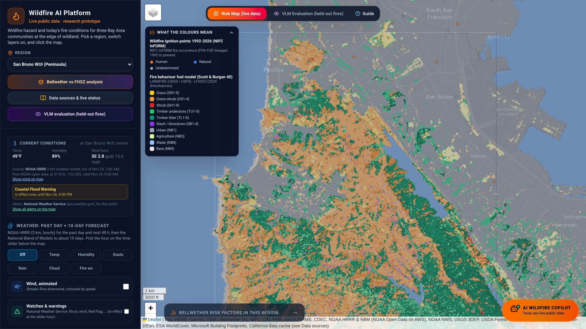

*LANDFIRE fuel models (grass-shrub in orange, timber litter in green) and wildfire ignition points since 1992
(orange: human-caused) around San Bruno and San Bruno Mountain.*

| Layer panel | Cache values at a clicked point |
|---|---|
| 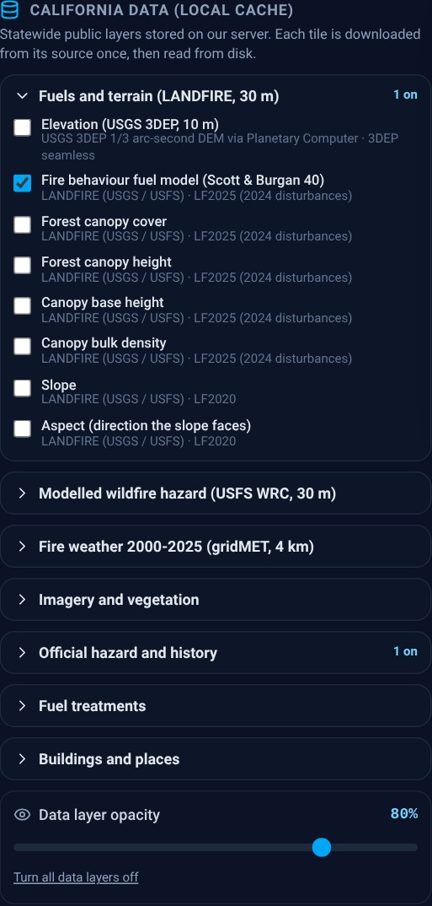 | 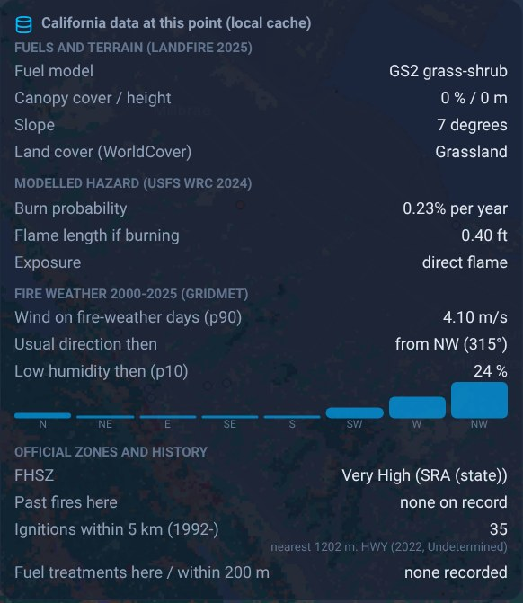 |

Coarse layers are downloaded for the whole state ahead of time; the fine ones (aerial photos, canopy height,
Sentinel-2) are fetched the first time a place is viewed and kept. How it works, the full layer list, the HTTP API
and the build commands: [`docs/DATA_CACHE.md`](docs/DATA_CACHE.md).

### 4.3 AI evaluation browser

This view (the **VLM Evaluation** tab at the top of the page) shows the evaluation from
[sections 2 and 3](#2-how-we-test-it) home by home: every test home, the true outcome, and every model's answer.
This section explains in detail what the true outcome is, how the test sets were built, what each model was asked,
how its answers were scored, and which experiments were run.

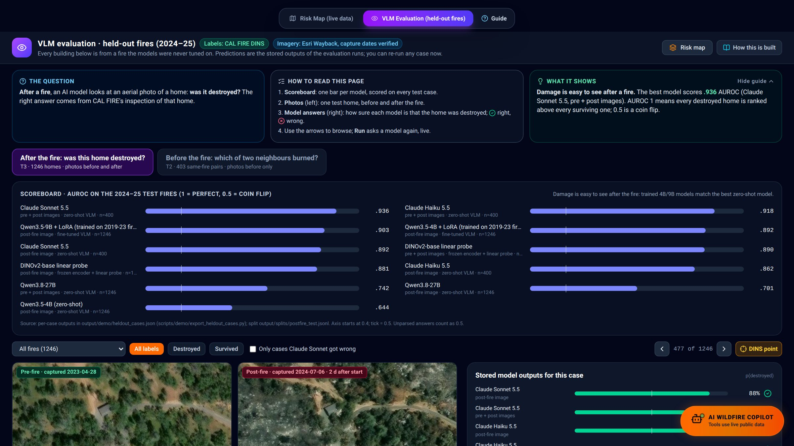

#### Ground truth: CAL FIRE damage inspections

After a fire, CAL FIRE inspection teams visit every structure inside the fire area and record its damage in the
Damage Inspection database (DINS), with the structure's location, type and year built. DINS uses five damage levels:

| DINS damage level | Meaning | Label used here |
|---|---|---|
| No Damage | No visible damage | survived |
| Affected | 1–10% of the structure damaged | survived |
| Minor | 10–25% damaged | survived |
| Major | 25–50% damaged | **destroyed** |
| Destroyed | more than 50% damaged | **destroyed** |

The inspector's label is the *ground truth*: a model's answer counts as right when it matches it. Only residential
structures are used. Each home's DINS location is the centre of its photo, and the model is told that the home to
judge is at the centre. Two known limits of this ground truth: an inspection point can sit slightly off the building,
and the line between Minor and Major is a judgement call by the inspector.

#### The test sets

All test homes come from fires in 2024–25 that no model was trained or tuned on, and both of their photos have a
verified capture date (see [section 2](#2-how-we-test-it)).

- **T3, after the fire: 1,246 homes from 83 fires.** Homes were drawn at random, at most 40 per fire and damage
  level, so that a few very large fires do not dominate. 319 were destroyed (227 Destroyed, 92 Major) and 927 survived
  (658 No Damage, 151 Affected, 118 Minor). The post-fire photo was taken a median of 77 days after the fire started
  (at most 347 days), at about 0.34 m per pixel.
- **T2, before the fire: 403 pairs from 13 fires.** Each pair is a destroyed home and a surviving home from the same
  fire, 16–99 m apart (median 74 m). Each destroyed home is used once, and no fire contributes more than 85 pairs. The
  pre-fire photos were taken a median of 461 days before the fire.
- **T1, before the fire: 238 single homes from 8 fires**, half destroyed and half survived.
- **Replication set:** 289 pairs and a matching set of single homes from separate 2019–23 fires, kept aside to repeat
  the before-the-fire tests.

#### What each model is given and asked

Every model sees the same prompt for the same task:

- **Context, for every task:** that this is a residential building in a California wildland-urban interface fire
  which reached the community; the building's structure type and year built; the fire's name, county and start
  date. No weather is stated.
- **Photos:** a 512 × 512 pixel crop, about 150 m across, centred on the home. For T3 the model gets the post-fire
  photo (and is told how many days after the fire it was taken), or the photos before and after. For T2 it gets one
  pre-fire photo of each home, labelled A and B, and the distance between them; the A/B order was drawn at random once per pair.
- **Question:** T3 and T1 ask for the probability (0–100) that the building was destroyed, as a JSON answer with up
  to three pieces of evidence. T2 says that exactly one of the two was destroyed, and asks for the probability that A
  was the one, with up to three differences.

Zero-shot models are called once per case. The fine-tuned Qwen models and the linear
probe are trained only on the 1,646 training homes from 2019–23 fires. A fine-tuned model's score is the probability
it gives to the answer "destroyed" as its first word, rather than a number it writes out (see experiment 3 below).
Because the Claude API costs money per call, the Claude models answered a fixed subset of 400 T3 homes, drawn at
random within each fire and outcome; every Claude run used the same 400.

#### How the answers are scored

- **One case:** a model's answer is shown as right (green) when its probability is on the same side of 50% as the
  inspection: above 50% for a destroyed home, below for a survivor. In a pair it is right when it gives the destroyed
  home the higher probability.
- **AUROC (T1, T3):** across all test homes, the chance that the model gives a randomly chosen destroyed home a
  higher probability than a randomly chosen survivor. It does not depend on where the 50% line falls. 1 is perfect,
  0.5 is a coin flip.
- **Pair accuracy (T2):** the share of pairs where the destroyed home got the higher probability; a 50/50 answer
  counts as half right. 0.5 is a coin flip.
- **Unreadable answers** (no valid JSON) count as 50%, so a model cannot gain by failing to answer. At most 1.5% of
  any model's answers were unreadable.
- **Uncertainty:** 95% confidence intervals come from a bootstrap that resamples whole fires, because homes in the
  same fire are not independent. Two models are compared on exactly the same homes.
- **Rules fixed in advance:** for the replication and for the post-fire fine-tuning, the hypotheses, metrics and
  pass/fail rules were committed to this repository before the runs they judge.

The scoreboard in the browser is recomputed by the server from the same stored per-case answers that the case view
shows, so every number can be traced to individual answers.

#### The experiments

The browser shows the stored answers for T3 and T2. The table lists every experiment behind the findings; the full
numbers and confidence intervals are in [docs/RESULTS.md](docs/RESULTS.md).

| # | Experiment | What it tests | Result |
|---|---|---|---|
| 1 | Post-fire photo alone vs. photos before and after (T3) | Does seeing the "before" help? | Yes: Claude Sonnet .892 → .936 |
| 2 | Fine-tuning a 4B and a 9B open model on 1,646 homes (T3) | Can a small open model learn the task? | .644 → .892 (4B) and .903 (9B); ties the linear probe (.881) |
| 3 | Probability of the first word vs. a written number (T3) | How should a model's answer be read? | Same 4B model: .762 vs .644 |
| 4 | Four similar labelled examples added to the prompt (T3) | Does showing examples help without training? | No clear gain (+.019 for Qwen, −.012 for Sonnet) |
| 5 | Five damage levels instead of two (T3) | Can models grade damage? | Hard for every model (macro-F1 .36 at best); Minor and Major are not told apart |
| 6 | An out-of-state fire: 2021 Marshall Fire, Colorado (T3) | Does it transfer outside California? | All models ≈ .98; too easy to separate the methods |
| 7 | Photos vs. building records only (T2) | Do the photos add anything? | Claude Sonnet .620 with photos vs .578 without |
| 8 | The home's own photo vs. another home's photo (T1) | Does the model actually use the photo? | Yes: with the wrong photo Sonnet's AUROC drops by .07 on the test fires and .155 on the separate fires (confirmed) |
| 9 | A fixed "Red Flag Warning" sentence in the prompt (T1) | Do dramatic prompts bias the answer? | False alarms rise by about 16 percentage points |
| 10 | Repeating T1/T2 on separate fires, rules fixed in advance | Does the pre-fire result hold? | Sonnet pairs .555; not significantly better than a coin flip after correction |
| 11 | Measured vegetation and building spacing around each home (T2) | Does an explicit "defensible space" measurement do better? | No: .556 pair accuracy |
| 12 | The inspectors' own records of roof, vents, siding and decks (T2) | How high could building details go at best? | .63–.65; whether a detail was recorded at all gives .88, but that is a leak, not a signal |
| 13 | Random home split vs. split by fire and year | Does the way of splitting inflate scores? | Pre-fire AUROC .712 vs .551 |

#### Using the browser

**One case, after the fire (T3).** The photos before and after the fire, with their capture dates; the inspection
result; each model's answer (green when it agrees with the inspection, red when not); and the evidence the model
cited. Filters select a fire, an outcome, or only the cases Claude Sonnet got wrong. **Run this case now** sends the
same photos and the same prompt to a model again (this needs a model API key on the server).

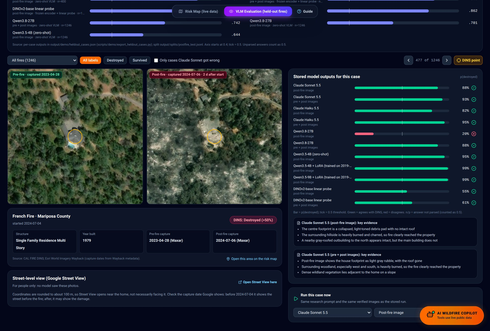

**One pair, before the fire (T2).** The two homes are shown in the same A/B order the models saw. The outcome stays
hidden until you press **Reveal**, so you can make your own guess first.

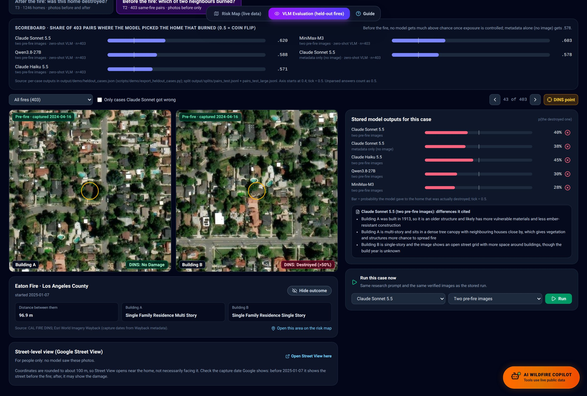

*Aerial photos: Esri World Imagery Wayback.*

### 4.4 Street-level view

Aerial photos show roofs, but not walls, vents, decks or what is stacked beside a house. To look at a home from the
street, the demo links to Google Street View:

- **In the AI evaluation browser**, the *Street-level view* panel under each case opens Street View at the home. For
  the before-the-fire pairs it appears only after **Reveal**, because a street photo taken after the fire would give
  the answer away.
- **On the risk map**, the **Street View** link in the location summary opens Street View at the clicked point.

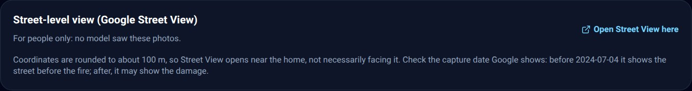

Street View photos are not stored by this project and were not given to any model. Google shows each photo's capture
date: a photo taken before the fire start shows the street before the fire; a later one may show the damage. Home
locations are rounded to about 100 m (see Privacy below), so Street View opens near the home, not necessarily facing
it. With a Google Maps Embed API key set when the frontend is built, the panorama opens inside the page.

**Privacy.** Street addresses, parcel numbers and assessed values are never sent to the browser, and home locations
are rounded to about 100 m.

## 5. What comes next

**Research**

| Plan | Why | Status |
|---|---|---|
| Train the post-fire models on more fires, including fires before 2019 | Test whether more varied training data moves fine-tuned VLMs ahead of the simple linear probe. Only about 22% of homes have a usable photo within a year after their fire, so data are scarce. | In progress |
| Measure how well people do on the same pre-fire photos | If people cannot tell either, the limit lies in what aerial photos show, not in the AI models. Images and an annotation kit are ready. | Needs annotators |
| Add the real weather at the time of each fire | The pre-fire tests deliberately state no weather. Hourly HRRR weather is archived on AWS back to 2014, so the actual wind and humidity at each home can be added. | Planned |
| Test street-level photos dated before each fire | Walls, vents and decks are invisible from above; Street View photos taken before the fire could show them. | Planned |
| Go beyond a yes/no score after a fire | Damage grades (none, minor, major, destroyed) and "not sure" answers would make damage surveys more useful. Current models cannot yet separate minor from major damage. | Planned |

**Web demo**

| Plan | Why | Status |
|---|---|---|
| Past weather on the time slider | Replay the weather of a past fire, for example the 2020 CZU Lightning Complex, from the same NOAA archive. | Planned |
| More regions and the whole state | The California data cache covers the whole state; the region list, the building layer of the live map and the Bellwether layer are still limited to three Bay Area communities. | In progress |
| Fire-spread scenarios | Run an open fire-spread model (for example ELMFIRE or Pyretechnics) on the cached fuels, terrain and fire-weather winds, to see which vegetation carries fire towards homes. | Planned |
| A public deployment | Reading weather straight from NOAA removed the last rate-limited source, so the demo can be hosted for outside users. | Planned |

## 6. Run it yourself

**Web demo.**

```bash
# backend, from the repository root (Python 3 with fastapi uvicorn requests numpy pandas pyarrow rasterio scipy
# shapely pillow scikit-learn pyproj eccodes)
python3 scripts/demo/export_heldout_cases.py     # once: collects the stored evaluation answers for the browser
export CLAUDE_API_KEY=...                        # optional: "Run this case now"
export MINIMAX_API_KEY=...                       # optional: AI copilot
python3 -m uvicorn backend.main:app --port 8000  # also starts the NOAA weather download

# frontend
cd frontend && npm install && npm run build && npm run start   # open http://localhost:3000
```

- The first start downloads about 1.3 GB of weather data in a few minutes; `WX_INGEST=0` switches this off.
- The California data cache is built separately (several hours, tens of GB); see [`docs/DATA_CACHE.md`](docs/DATA_CACHE.md).
  Without it, the raster layers are fetched from their sources as they are viewed; the fire-weather and vector
  layers need the build step.
- Build-time options: `NEXT_PUBLIC_API_BASE=http://host:8000` for a backend elsewhere;
  `NEXT_PUBLIC_GOOGLE_MAPS_EMBED_KEY=...` for the in-page Street View panorama.
- The map needs only internet access (plus the partner files for the Bellwether layer). The evaluation browser needs
  the local evaluation outputs (`output/`, not in the repository) and the downloaded Wayback photos.
- Links can open a specific view, e.g. `/?region=santa_cruz&layers=perimeters,fhsz` or
  `/?mode=vision&task=t2&case=p0042`.
- The screenshots in this README are made by `scripts/demo/readme_screenshots.py`; the tutorial video by
  `scripts/demo/record_tutorial.py` and `make_readme_media.py`.

**Research pipeline.**

```bash
python scripts/data/build_research_splits.py              # splits by fire event and year
python scripts/eval/run_vlm_conditions.py --help          # single-home tests (T1, T3)
python scripts/eval/run_vlm_pairs.py --help               # neighbour pairs (T2)
```

- Photos with verified capture dates: [`src/vlm_benchmark/imagery_provenance.py`](src/vlm_benchmark/imagery_provenance.py).
- Fine-tuning for T3: `scripts/train/sft_postfire_qwen.py`. Baselines and analyses: `scripts/eval/`.
- Results are written to `output/` (not in the repository); result tables are generated from there, never typed in
  by hand.
- API keys are read from the environment (`CLAUDE_API_KEY` or `ANTHROPIC_API_KEY`, `QWEN_REMOTE_KEY` with
  `TB_REMOTE_QWEN_URL`, `MINIMAX_API_KEY`) and are never stored in the repository.

## 7. Repository, documents and licences

| Folder | Contents |
|---|---|
| `frontend/` | Web demo (Next.js, Leaflet) |
| `backend/` | API for the demo (FastAPI): live data sources, NOAA weather download, evaluation browser |
| `scripts/data/`, `scripts/eval/`, `scripts/train/` | Building datasets, running and scoring models, fine-tuning |
| `scripts/demo/` | Tutorial video and README screenshots |
| `src/vlm_benchmark/` | Photo download with verified dates; evaluation service |
| `docs/` | The documents below and the images in this README |

| Document | Contents |
|---|---|
| [`docs/RESULTS.md`](docs/RESULTS.md) | All experiments and results, with the script behind each number |
| [`docs/CONFIRMATORY_PLAN.md`](docs/CONFIRMATORY_PLAN.md) | Plan for repeating the key tests on separate fires, registered before the runs, and its results (in Chinese) |
| [`docs/POSTFIRE_TASK_PLAN.md`](docs/POSTFIRE_TASK_PLAN.md) | Plan and decision rules for the after-the-fire task, registered before the runs, and its results (in Chinese) |

**Data sources and licences**

| Source | Terms |
|---|---|
| CAL FIRE damage inspections, hazard zones, fire perimeters, incidents | Public records |
| Esri World Imagery / Wayback | Esri terms of use; photos are not redistributed |
| NOAA HRRR, NBM and NWS alerts; NASA FIRMS; USGS 3DEP; CDEC | US public data |
| NIFC WFIGS and Operational Data Archive | Public domain |
| USDA Forest Service, Wildfire Risk to Communities | Public; cite Scott et al. 2024, [doi:10.2737/RDS-2020-0016-2](https://doi.org/10.2737/RDS-2020-0016-2) |
| Copernicus Sentinel-2 (via Esri) | Copernicus open licence; Esri terms |
| Microsoft US Building Footprints | ODbL |
| ESA WorldCover 2021; ERA5 weather via Open-Meteo | CC BY 4.0 |
| Google Street View | Linked or embedded through Google; not stored |
| Bellwether hazard files | Shared by the partner; not redistributed |
