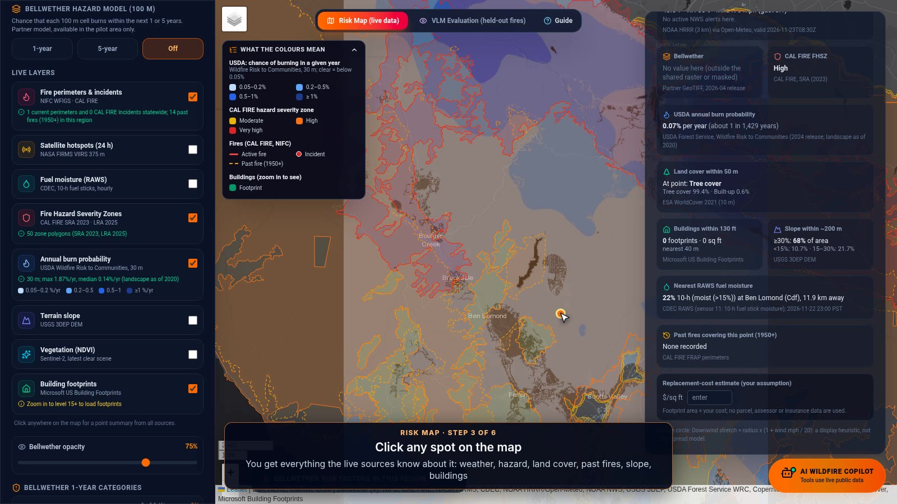
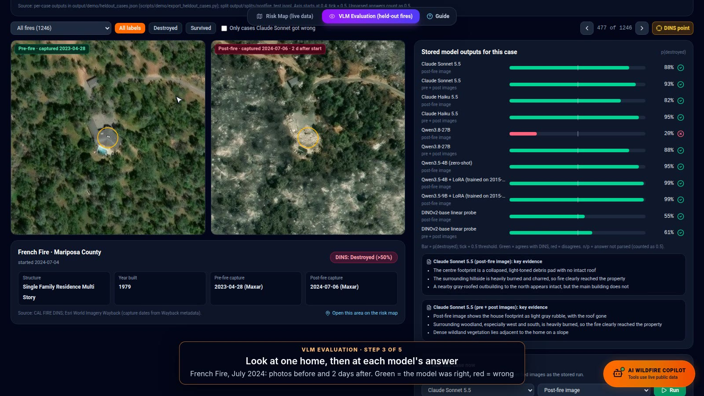

# Wildfire AI: verifiable evaluation of vision-language models for structure loss

Research code for evaluating whether vision-language models (VLMs) can tell, from aerial imagery, which homes
**will be** destroyed in a wildfire (pre-fire) and which **were** destroyed (post-fire), against real outcomes
from CAL FIRE damage inspections (DINS).

[](docs/assets/tutorial.mp4)

*How to use the web demo, recorded from the running app. **[Watch the full 3-minute tutorial](docs/assets/tutorial.mp4)**
(captions, no audio). Details in [Web demo](#web-demo).*

The repository has two parts:

1. **The research pipeline** (`scripts/`, `src/vlm_benchmark/imagery_provenance.py`). Every number it produces
   is computed from real records and real model outputs. What is and is not established is tracked in
   [`docs/EVIDENCE_STATUS.md`](docs/EVIDENCE_STATUS.md), the single source of truth for results.
2. **A web demo** (`backend/`, `frontend/`) with two views: a risk map on live public data, and a browser for the
   held-out VLM evaluation. See [Web demo](#web-demo).

## Research pipeline

**Data and splits.**
- 132,522 DINS records; the residential binary label is Destroyed + Major vs. No Damage / Affected / Minor.
- Splits are by fire event and forward in time: train on 2019–23 fires, test on 2024–25 fires.
- The 50-case legacy development set is quarantined, and buildings near another split's buildings are excluded
  (100 m buffer).

**Imagery provenance.** [`src/vlm_benchmark/imagery_provenance.py`](src/vlm_benchmark/imagery_provenance.py)
fetches Esri World Imagery Wayback crops and records each crop's verified per-location **capture date**, not just its
release date.
- A pre-fire crop must be captured before the fire.
- A post-fire crop is the earliest capture within 365 days after the fire.
- There is no fallback to current imagery: if the capture date cannot be verified, the sample is rejected.

**Tasks.**

| Task | Question | Main script |
|---|---|---|
| T1 | Pre-fire, single building: P(destroyed) | `scripts/eval/run_vlm_conditions.py` |
| T2 | Pre-fire, same-fire neighbour pairs 15–100 m apart (exposure-controlled): which one was destroyed? | `scripts/eval/run_vlm_pairs.py` |
| T3 | Post-fire damage recognition | `scripts/eval/run_vlm_conditions.py --evidence postfire_image`, `scripts/train/sft_postfire_qwen.py` |
| Replication | Pre-registered confirmatory tests on untouched validation fires | `scripts/eval/confirmatory_analysis.py`, [`docs/CONFIRMATORY_PLAN.md`](docs/CONFIRMATORY_PLAN.md) |

**Baselines and analyses.** All are in `scripts/eval/`:
- tabular models
- frozen DINOv2/SigLIP probes and a pair ranker
- fine-tuned DINOv2
- masking, resolution and split-inflation analyses
- missingness leakage
- retrieval

**Scoring.** VLM answers that fail to parse count as p = 0.5 (intention-to-treat). Result tables are generated
only from `output/`, never typed in by hand.

**Exploratory pilots (2026-10-22, feasibility only).**
- *Community-scale risk:* `scripts/data/build_community_cells.py`, `worldcover_features.py`.
- *Evacuation-decision replay:* archived NIFC perimeters, with no future information at decision time.
  See `scripts/data/evac_perimeter_inventory.py`, `build_evac_replay.py`, `ms_building_cells.py`,
  `render_evac_maps.py`, `scripts/eval/evac_baselines.py` and `run_evac_vlm.py`.

**External datasets (2026-10-23).**
- *Out-of-state post-fire test (2021 Marshall Fire, Colorado):* BRIGHT building labels with verified Wayback
  imagery. See `scripts/data/build_marshall_external.py` and `scripts/eval/postfire_external_eval.py`.
- *Defensible-space features:* an OpenEarthMap segmenter (DINOv2-base) measures vegetation and buildings in rings
  around each home. See `scripts/data/prepare_oem.py`, `scripts/train/train_oem_segmenter.py` and
  `scripts/eval/defensible_space_{features,eval}.py`.
- Results for both are in `docs/EVIDENCE_STATUS.md` §4e.

`output/` is git-ignored. API keys are read from the environment (`CLAUDE_API_KEY` / `ANTHROPIC_API_KEY`,
`QWEN_REMOTE_KEY` with `TB_REMOTE_QWEN_URL`, `MINIMAX_API_KEY`) and are never stored in the repository.

### Documentation

| Document | Content |
|---|---|
| [`docs/EVIDENCE_STATUS.md`](docs/EVIDENCE_STATUS.md) | Claims ledger: the evidence level of every result |
| [`docs/CONFIRMATORY_PLAN.md`](docs/CONFIRMATORY_PLAN.md) | Pre-registration and results of the replication |
| [`docs/POSTFIRE_TASK_PLAN.md`](docs/POSTFIRE_TASK_PLAN.md) | Pre-registration and results of the post-fire task |
| [`docs/VLM_ROLE_AND_BASELINE_DESIGN.md`](docs/VLM_ROLE_AND_BASELINE_DESIGN.md) | How VLMs are used, and which baselines they are compared with |
| [`docs/RELATED_WORK_WIRC.md`](docs/RELATED_WORK_WIRC.md) | Related work (SJSU WIRC survey) |
| [`docs/archive/`](docs/archive/) | **Archived** pre-10-19 documents, each headed by a list of known errors. Not a source of results. |

### Data sources and licences

| Source | Terms |
|---|---|
| CAL FIRE DINS | Public records |
| Esri World Imagery / Wayback | Esri terms of use; crops are not redistributed |
| NIFC Operational Data Archive | Public domain |
| Microsoft US Building Footprints | ODbL |
| ESA WorldCover 2021 | CC BY 4.0 |
| ERA5 via Open-Meteo | CC BY 4.0 |
| USDA Forest Service, Wildfire Risk to Communities | Public; cite Scott et al. 2024, [doi:10.2737/RDS-2020-0016-2](https://doi.org/10.2737/RDS-2020-0016-2) |
| Bellwether rasters | Shared by the partner; not redistributed |

## Web demo

**[Tutorial video (3 min)](docs/assets/tutorial.mp4)**: every step below, recorded from the running app.

A guide opens on the first visit and can be reopened with **Guide** at the top of the page.

| | Risk map | VLM evaluation |
|---|---|---|
| **The question** | Where could fire start or spread, and what are conditions right now? | Can AI tell from aerial photos which homes burn? |
| **1** | Pick a region (three Bay Area communities at the wildland edge). | Choose a question: *after the fire* (was this home destroyed?) or *before the fire* (which of two neighbours burned?). |
| **2** | Switch layers on and off; the legend on the map explains every colour. For weather, pick a field (temperature, humidity, gusts, rain, cloud, fire weather) and drag the time slider through the past day and the forecast; hover the map for values. | Read the scoreboard: one bar per model, scored on every test home. |
| **3** | Click any spot for a summary from all sources. | Look at one home's photos, then at each model's answer (green = right, red = wrong). |
| **4** | Open **Data sources & live status** to see where each number comes from. | Press **Run** to ask a model the same question live. |
| **5** | Ask the AI copilot; it answers from the same live data. | In the pre-fire pairs, guess first, then press **Reveal**. |

**Rule: nothing is mocked.** Every value on screen is either fetched live from a public service or read from a stored
output of this project's evaluation. If a source is down or has no data, the UI says so; it never shows a placeholder.

### View 1: risk map (live data)



Three regions: San Bruno, San Jose foothills and the Santa Cruz Mountains. **Data sources & live status** checks
every source when it opens.

Map data is cached twice: the browser keeps every layer it has loaded (memory and IndexedDB), so returning to a
region or panning back is instant and the copy is refreshed in the background; the server keeps HRRR values per
grid point in `backend/cache/` and, if a source stops answering, serves the last good values marked with their time.

| Layer / panel | Source (fetched live unless noted) |
|---|---|
| Bellwether 1-year / 5-year hazard, risk drivers | Partner GeoTIFFs (local files, pilot area only: about 55% of cells valid; San Jose is not covered) |
| Annual burn probability | USDA Forest Service, Wildfire Risk to Communities (2024 release, 30 m; landscape as of end-2020), public image service |
| Current perimeters, CAL FIRE incidents | NIFC WFIGS; incidents.fire.ca.gov |
| Historic perimeters (1950+) | CAL FIRE FRAP |
| Satellite hotspots (24 h) | NASA FIRMS VIIRS public CSVs (S-NPP, NOAA-20, NOAA-21) |
| Fuel moisture | CDEC RAWS, 10-h fuel sticks, hourly |
| Current conditions (temperature, humidity, wind at the region centre) | NOAA HRRR 3 km model via Open-Meteo; NWS alerts for that point |
| Weather layers with time slider (past 24 h to about +46 h): temperature, humidity, gusts, rain, cloud, Fosberg fire-weather index, animated wind | NOAA HRRR via Open-Meteo, hourly, on fixed map tiles (0.03° when zoomed in, up to 2° for the whole state) |
| Weather watches, warnings, advisories (Red Flag, wind, flood, coastal flood, ...) | National Weather Service api.weather.gov, all of California, drawn on NWS forecast-zone shapes for the hour on the slider; refreshed every 5 min |
| Terrain slope | USGS 3DEP DEM, slope computed on request |
| Vegetation (NDVI) | Sentinel-2 via Esri, one dated scene with ≤10% cloud |
| Fire Hazard Severity Zones | CAL FIRE FHSZ (SRA 2023, LRA 2025) |
| Land cover | ESA WorldCover 2021 |
| Building footprints | Microsoft US Building Footprints (local file) |

**Two hazard layers.** Bellwether is partner data and is available only in the pilot area. The USDA Wildfire Risk
to Communities annual burn probability is public and covers the whole country, so the map works anywhere without
partner data. The two differ in method and date: Bellwether is a machine-learning forecast for 2026–27 and 2026–31,
while USDA's FSim simulation reflects the landscape as of 2020. The public service stores probability × 10,000;
the app converts it back (the published range is 0–0.14 per year).

- **Point summary.** Click anywhere on the map to combine all sources at that point.
- **Bellwether vs FHSZ.** Compares the partner model with the state hazard map, cell by cell, where Bellwether
  has values.
- **AI copilot.** Answers with the same live tools and is instructed not to invent values. It needs an LLM key on
  the backend (MiniMax by default).

### View 2: VLM evaluation (held-out fires)



The view browses the **2024–25 held-out test fires**, which no model was trained or tuned on:

- **Post-fire (T3):** 1,246 buildings, with pre- and post-fire Wayback crops whose capture dates are verified.
- **Pre-fire pairs (T2):** 403 same-fire neighbour pairs, shown in the same A/B order the models saw. The outcome
  stays hidden until you click **Reveal**.

For each case you see:

- the CAL FIRE DINS label;
- every model's **stored output**: Claude Sonnet / Haiku 5.5, Qwen3.8-27B, Qwen3.5-4B zero-shot, Qwen3.5-4B/9B +
  LoRA and the DINOv2 linear probe;
- the model's cited evidence.

The scoreboard is computed from the same per-case outputs: T3 AUROC .892 for Sonnet, .892 / .903 for the LoRA
models and .881 for DINOv2; T2 pair accuracy .571–.620.

**Run this case now** re-sends the case to Claude (or to Qwen, if configured), using the exact research prompt and
images. It needs `CLAUDE_API_KEY` on the backend.

**Privacy.** Street addresses, APNs and assessed values are not sent to the browser, and coordinates are rounded to
about 100 m.

### What's new (22 Nov 2026)

- **VLM evaluation on held-out fires**: per-case outputs of every model, verified imagery, and a live re-run.
- **USDA Wildfire Risk to Communities** burn probability as a public, nationwide hazard layer.
- **Easier to read for first-time visitors**: a guide on the first visit, a map legend that follows the layers you
  switch on, a "click anywhere" hint, and a plain-language explanation of each VLM task and its result.
- **Tutorial video** (`scripts/demo/record_tutorial.py`, `make_readme_media.py`).
- **AI copilot** answers render as formatted text (lists, tables, bold).
- The older 50-case development-set endpoints (`/api/vlm/benchmark/results`, `/metrics`, `/api/vlm/predict`) are
  retired and return HTTP 410.

### Running the demo

```bash
# backend (repo root); Python 3 with fastapi uvicorn requests numpy pandas pyarrow rasterio scipy shapely pillow scikit-learn
python3 scripts/demo/export_heldout_cases.py     # once: builds output/demo/heldout_cases.json from output/experiments/
export CLAUDE_API_KEY=...                        # optional: "Run this case now"
export MINIMAX_API_KEY=...                       # optional: AI copilot
python3 -m uvicorn backend.main:app --port 8000

# frontend
cd frontend && npm install && npm run build && npm run start   # http://localhost:3000
# NEXT_PUBLIC_API_BASE=http://host:8000 at build time to use another backend
```

The VLM view needs the local research outputs (`output/`, git-ignored) and the Wayback crops under
`/data/wildfire_benchmark_data/`. The map view needs only internet access, plus the Bellwether rasters for the
Bellwether layer. Deep links:
`/?region=santa_cruz&layers=perimeters,fhsz`, `/?mode=vision&task=t2&case=p0042`.

## Quick start (research pipeline)

```bash
python scripts/data/build_research_splits.py              # event-level, forward-in-time splits
python scripts/eval/run_vlm_conditions.py --help          # zero-shot VLM conditions (T1 / T3)
python scripts/eval/run_vlm_pairs.py --help               # exposure-controlled pairs (T2)
```
